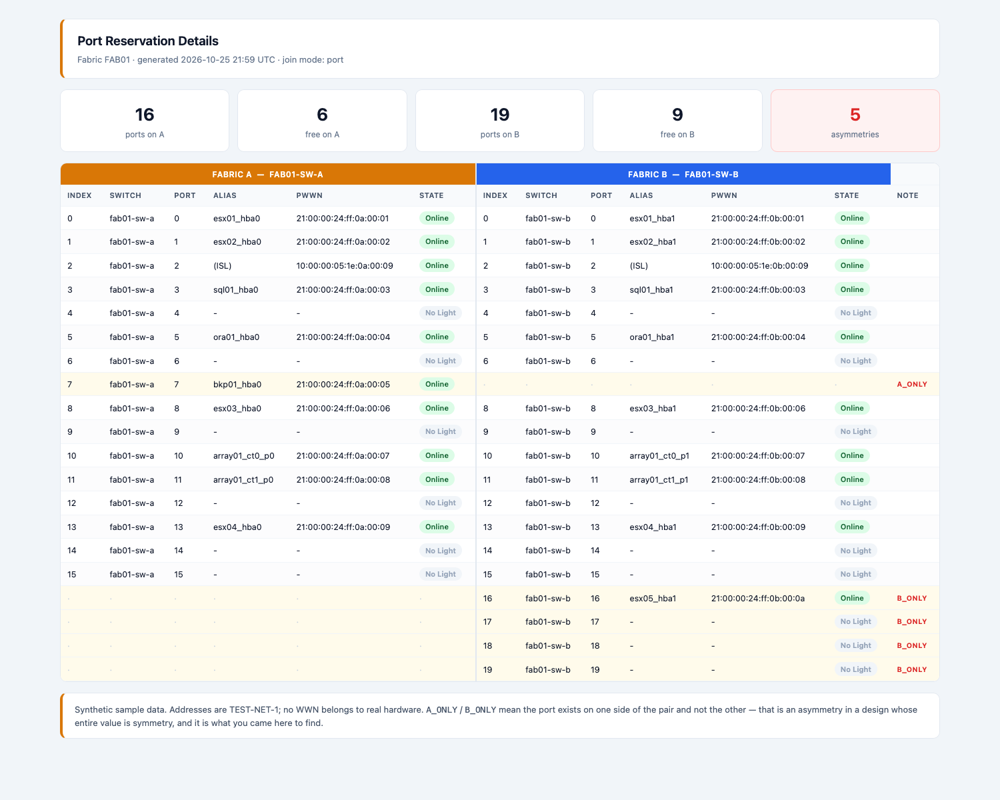
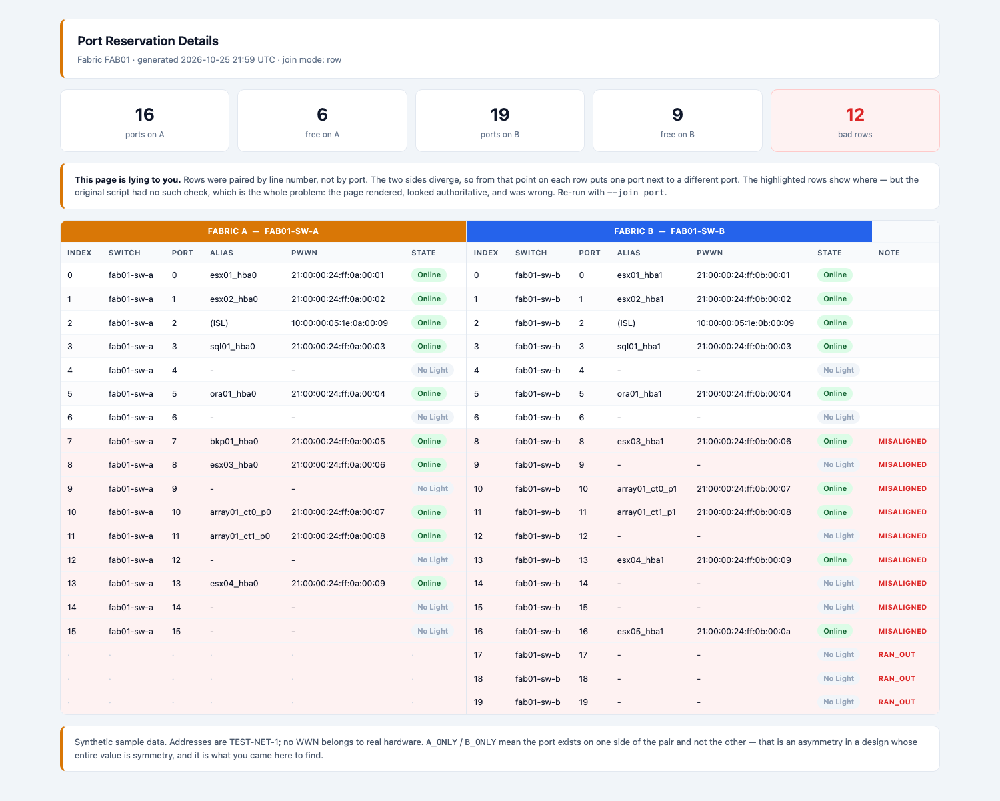
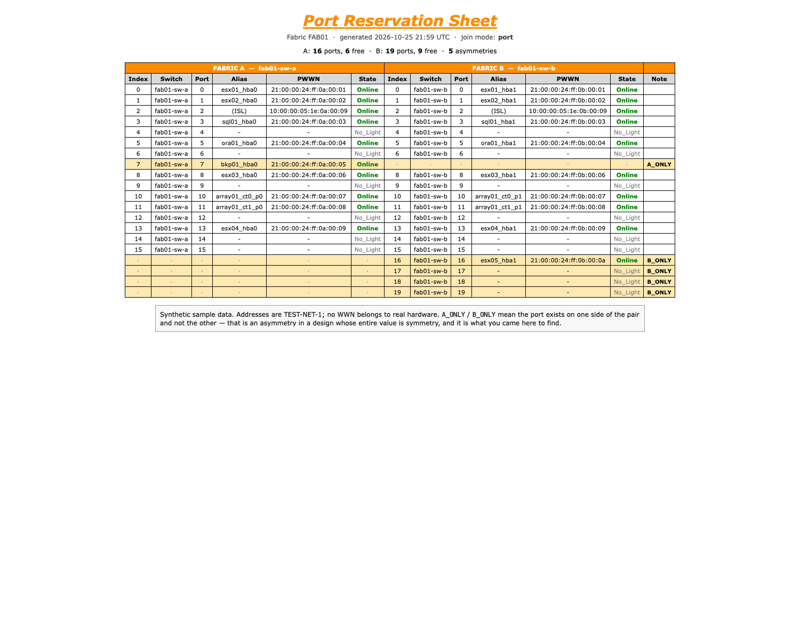

# fabric-compare

Put both sides of a redundant SAN fabric on one page.

A storage fabric is built as a pair — A and B — two physically separate networks, either able to carry everything alone. The redundancy isn't in having two fabrics. It's in the two fabrics being equivalent. Almost every tool shows you one switch, or one fabric, at a time, which means checking that they *are* equivalent is a manual job nobody does often enough.

This is a small, dependency-free script that polls both sides, joins them, and renders them next to each other.



Ports present on one side and not the other are flagged. In the sample above, `bkp01` has a path on fabric A and nothing on fabric B — a single-pathed host in a design whose entire point is that nothing is single-pathed. That is the thing you came here to find.

## Quick start

No dependencies beyond a POSIX shell and `awk`. Sample captures are bundled, so it runs offline:

```sh
./fabric-compare.sh                  # writes fab01_classic_port.html
open fab01_classic_port.html
```

Collect from real switches instead:

```sh
./fabric-compare.sh --live --data /path/to/conf
```

The live path runs `switchshow` and `alishow` over SSH — the same two commands you'd run by hand. It is included because collection is the point of the tool, but it has only been exercised against the bundled captures, not against hardware.

## The two join modes

This is the interesting part, and the reason the repo exists in this shape.

```sh
./fabric-compare.sh --join port   # default — join on port index
./fabric-compare.sh --join row    # join on line number
```

`--join row` reproduces what the original 2011 version of this did: write each side to its own file and glue them together with `paste(1)`, line one next to line one. That is correct exactly as long as both sides emit the same number of lines in the same order. The moment they don't — different switch models in the pair, an unlicensed port block, a port missing from one output — every row below the divergence compares one port against a different port.

The page still renders. It still looks authoritative. It is wrong, and nothing tells you:



Same data, same tool. The highlighted rows are where fabric A's port *N* is sitting beside fabric B's port *N+1*, presenting two unrelated devices as a redundant pair.

The `MISALIGNED` and `RAN_OUT` flags are a diagnostic added here to make the failure visible. The original had no such check — which is precisely the problem with it. A comparison that is correct by coincidence of ordering rather than by matching keys will fail silently, and silent is the worst way for a report to fail.

`--join port` joins on the key the data actually has.

## The two renderings

The same comparison, presented two ways:

```sh
./fabric-compare.sh --style classic   # default — close to the 2011 original
./fabric-compare.sh --style modern    # the same data as it would be presented today
```

`classic` is roughly what the original emitted: a bordered table, Verdana, an orange italic heading, everything on one page with no styling worth the name.



`modern` is the same numbers with fifteen more years of browser behind them — summary cards at the top, the two fabrics colour-split so your eye can tell at a glance which side it's reading, state as a pill rather than a word.

Both are in here on purpose. The comparison is identical; only the presentation differs. Nothing about the hard part of this problem — knowing which port on A corresponds to which port on B — got easier in fifteen years. The rendering got easier. That gap is the whole point of keeping both.

Output is named `<fabric>_<style>_<join>.html`, so all four combinations can coexist.

## Input format

`switch_list` — whitespace separated, `#` comments ignored:

```
# side  switch_name   address      fabric
A       fab01-sw-a    192.0.2.11   fab01
B       fab01-sw-b    192.0.2.12   fab01
```

A fabric with only a side A entry renders single-width rather than failing.

In offline mode the script reads `<fabric>_<side>.switchshow` and `<fabric>_<side>.alishow` from the data directory.

## Known limitations

- Parses `switchshow` text. Reading a structured API would be better and is the right fix; this exists to mirror what the original did. [What an API-backed version looks like](docs/modern-version.md) is written up separately.
- Header detection keys off the `=====` separator rather than enumerating known header strings. Shorter, and it doesn't break when a firmware release adds a new header line — but it does assume the separator is present.
- Alias resolution takes the first alias matching a port's WWN. A WWN in more than one alias will resolve to whichever comes first.
- Brocade output only. The same shape of problem exists on Cisco and on ordinary network switches; the parsing would need to change, the join would not.

## Sample data

Entirely synthetic. Addresses are from `192.0.2.0/24` (TEST-NET-1, reserved for documentation). No WWN, switch name, alias or address refers to real hardware anywhere.

The two sides are deliberately asymmetric so both join modes have something to show: side A has a port that side B doesn't, and side B is a larger switch with ports A has no equivalent for. Both are ordinary situations in a real fabric.

## Background

Written up in [Port Reservation Details](#) — why this gap existed in 2011, why it still does, and what I'd build differently now.

## Licence

MIT.
